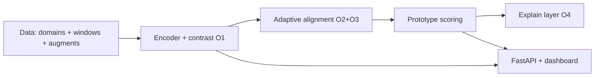

# DESIGN.md — architecture, math, decisions, limitations

## Architecture

## Tensor convention
`(T, C)` series, `(B, T, C)` windows/batches, `(B, d)` reps, `(B, T)` attention.

## Loss math
- InfoNCE (NT-Xent, τ): `L = -log exp(sim(z1,z2⁺)/τ) / Σ exp(sim/τ)` over 2B views (`losses/contrastive.py`).
- TS2Vec-hierarchical (simplified): instance + temporal contrast at pooled scales ×(1, ½, …).
- Masked recon: MSE on masked steps only.
- MMD² (multi-kernel RBF, **median-heuristic** σ ∈ {½m, m, 2m}): `E[k(x,x)] + E[k(y,y)] − 2E[k(x,y)]`.
- CORAL: `‖Cov_s − Cov_t‖_F²/d² + ‖μ_s − μ_t‖²`.
- DANN: BCE(domain-disc(GRL_λ(z))), λ = 2/(1+e^(−10p)) − 1 (Ganin).
- Gate: g = σ(logits) (or hard-concrete); reg = mean(g) + 0.1·H(g).
- Weights: w = softmax(−d/mean(d)/τ), d = MMD/stats/proxy-A, τ = 1 (scale-free).
- Preserve: compactness E‖z−c‖² + hinge margin (pseudo-anomalies) + variance-floor no-collapse.
- Combined: `L = Lc + α_t·Σ_k w_k·L_align(k, gate) + β·L_preserve + γ·L_sparse`, α warm-up × monitor factor.

## Why each choice (alternative rejected)
- TCN default (fast CPU) over Transformer-only; max+mean pooling after proving mean-only dilution.
- Median-heuristic MMD after fixed-σ saturation diagnosis; input-space epoch weights after batch-rep failure.
- Noise-harmful domain after shift-harmful was erased by per-domain norm.
- Val-only calibration + guard band after smearing diagnosis; best-F1-on-val for transfer comparisons.
- Native attributors (zero-dep) + lazy captum/SHAP/LIME; Streamlit over Dash; OmegaConf over Hydra.

## Known limitations
1. Point-spike dilution (partly mitigated); 2. conservative unsupervised operating point; 3. seed-dependent
   neg-transfer on tiny data (needs 5-seed full runs); 4. PA reported only beside strict; 5. VUS/affiliation
   deferred; simplified Tatbul; 6. conditional alignment = chamfer option only; 7. /adapt = prototype-refresh,
   not full retrain.

## Threats to validity
- PA inflation → dual reporting + flagged tables. Test-label leakage → val-only thresholds/norm/prototypes
  (audit in Phase 11). Synthetic→real gap → SMD/SMAP loaders ready, graceful skip. Single-seed smoke claims →
  explicitly labeled pipeline-proof; paper claims await full runs. Random-encoder AUC shows data easiness —
  reported, not hidden.

## Phase 11 — final audit (implemented)
- `scripts/audit.py` -> `reports/audit.md`, 15/15 PASS: leakage (norm-guard, default-unlabeled,
  label-free steps, val-only thresholds), reproducibility (seed-identical data + init), gates, O1-O4 map.
- Closed in audit: weak supervision (SupCon on weak_frac of anomalous windows, `loss.w_sup` +
  `data.weak_labels`, both default 0); KernelSHAP backend (DeepSHAP incompatible with BatchNorm TCNs);
  `DATA=` wired (`train`/`eval` via `data/loaders.py`, graceful missing-data errors).
- Explicit remaining gaps: cond-alignment/DANN-CORAL E2E on GPU box, 5-seed stats, real-data numbers,
  VUS/affiliation, MLflow E2E, `make` absent on Windows (python equivalents verified).

## Phase 7 — API + dashboard (implemented)
- Bundle = one dir (encoder.pt, prototypes.npy, stats.json, config.yaml); /detect (JSON/CSV, pydantic,
  shape errors 400); /explain (full JSON object, 10-step IG for latency); /domains (bundle stats);
  /adapt (prototype-refresh: new norm + k-means bank on unlabeled upload, p95 threshold; encoder reused).
- Dashboard: Streamlit, direct bundle inference, client-side threshold slider. Plotly absent -> st.line_chart
  + matplotlib (documented substitution). Weights (*.pt) git-ignored; Dockerfile bakes bundle at build.

## Phase 6 — experiments E1–E8 (implemented)
- common: seed_cfg/ensure_defaults, save_all (CSV+MD+booktabs TEX), paired t/Wilcoxon, mean±std aggregation,
  barplot/heatmap. Dispatcher: --exp/--seeds/--all-smoke/--all.
- E1 baselines-vs-contrast; E2 pairs + gain vs target-only (source-val threshold, zero target labels);
  E3 none/MMD/CORAL/DANN/adaptive (+CORAL/DANN in full mode); E4 kinds{clean,shift,noise} + dissimilarity axis;
  E5 encoder + gate/weights/preserve/monitor toggles (+window/k in full); E6 gallery aggregation;
  E7 alpha×tau grid; E8 params/forward-ms/score-throughput (fit timed separately).
- Smoke = pipeline proof (1 seed, stats n/a); paper claims need 5-seed full runs (E4 seed-dependence documented).

## Phase 5 — explainability O4 (implemented)
- JSON explanation: prototype nearest/medoid + overlay; attention (B,T) w/ heatmap, unavailable-flag for TCN;
  native saliency/IG(20 steps)/smoothgrad + lazy captum/SHAP/LIME backends; GD counterfactual (sparse, bounded,
  plausible train-min/max, validity/sparsity/proximity); cross-domain (per-domain proto dists, gate dims);
  rule-based NL summary (no LLM).
- Metrics: deletion-AUC/sufficiency/comprehensiveness, rank-corr + top-k Jaccard stability, P@k/AUPRC
  localization vs GT masks, CF validity/sparsity/proximity; explainer comparison table in gallery.
- Score fn for grads: softmin prototype distance (differentiable); baseline = medoid normal window.

## Phase 4 — adaptive alignment O2+O3 (implemented, core novelty)
- Losses: MMD (median-heuristic bandwidths — fixed sigmas saturate in high-dim input space), CORAL, DANN
  (GRL + Ganin schedule). Combined: L = Lc + a_t*S w_k*L_align + b*Lp + g*Lsparse, warm-up then monitor-adapted.
- A gate g(z)E[0,1]^d (sigmoid/hard-concrete, L1+entropy); B scale-free weights softmax(-d/mean(d)/tau), tau=1,
  fit epoch-level on INPUT-space windows (batch rep-space weights were non-discriminative); C normal-only +
  compactness/margin/no-collapse; D monitor halves alpha + rollbacks on val-proxy degradation; E AdaBN TTA baseline.
- Ablations: none / mmd / coral / dann / adaptive_full (+cond chamfer option). Evidence: seed0 default-scale
  uniform-mixed collapses (0.318->0.0) while adaptive reaches 0.444 with related weight 0.67.

## Phase 3 — contrastive repr O1 (implemented)
- Encoders TCN/Transformer(attn exposed (B,T))/ResNet1D, (B,T,C)->rep (B,d); TCN/ResNet use max+mean concat
  (spike preservation). Losses: InfoNCE(tau) + TS2Vec-hierarchical + masked-recon aux, config-weighted.
- Lightning module (cosine, clip=1.0, early-stop, ckpt, 16-mixed on CUDA), labels UNUSED in training;
  prototypes fit on normal train windows (assumed-normal) + kNN/Mahalanobis options; window->timestamp mapping,
  smoothing, val-only calibration + guard band, hybrid emb+recon (when w_mask>0).
- Evidence: trained F1 3x random-encoder control; default-scale AUC 0.919 / event-recall 1.0.

## Phase 2 — eval + baselines (implemented)
- Metrics: strict P/R/F1 + AUC-ROC/PR, PA (flagged inflated), simplified event-wise + Tatbul-style range F1
  (VUS/affiliation deferred — noted limitation). Thresholds: best-F1(val labels)/percentile/POT/fixed, val-only.
- Bootstrap CIs + multi-seed mean±std; transfer_report (gain, negative_transfer bool, gap_to_target_only).
- 8 baselines: zscore/iforest/ocsvm/pca/arima(+numpy AR fallback)/lstm_ae/conv_ae/trans_ae.
  Contrastive no-adapt model lands in Phase 3 (O1).

## Phase 1 — data pipeline (implemented)
- `BaseTSADDataset` → `DomainData`; loaders: synthetic (shift knobs + 6 anomaly types + GT masks),
  SMD (machine), SMAP/MSL (entity), UCR (.npz), SWaT/Yahoo (access-required, graceful `DatasetMissingError`).
- Series-level time-ordered split → window after split (no overlap leakage); per-domain z-score fit-train-only
  (constant-ch std→1, NaN-safe); `DomainRegistry` protocols: single / source-target (unlabeled target-train) /
  LODO / multi-source; weak-label fraction flag (default 0); 9-augment `AugmentPipeline` + pseudo-anomaly util.

## Phase 0 decisions
- OmegaConf+YAML over Hydra (lighter); Streamlit dashboard (later); MLflow default, W&B behind flag + env key.
